# Using Machine Learning to Improve the Business of a Chain of Gardening Works Like The Grounds Guys

Technical title: An Explainable Ensemble Learning Framework for Plant Health Risk Prediction and Cost-Aware Landscaping Decisions.

Application: GreenScope — Lawn Health & Service Planning. An independent academic prototype. It is not software of The Grounds Guys and is not affiliated with that company.

Group number: 6

Course: M.Tech Computer Science and Engineering, 1st semester

Institute: Indian Institute of Technology Roorkee

Instructor: Professor Durga TOshniwal

Submission date: 27.10.2026

# 1. Abstract

This semester project builds GreenScope, a local decision-support prototype for lawn inspection. A reproducible generator creates 10,000 synthetic inspections and a separate 2,000-row robustness file. Four supervised classifiers — logistic regression, a random forest, gradient boosting, and a calibrated RBF support-vector machine — predict one simulated risk class: Low, Moderate, or High. Soft voting averages their probabilities. The application explains the model with permutation importance and a local baseline contrast, then applies transparent water, nutrient, and drainage screens and an editable cost sheet.

On the untouched test set of 1500 rows, soft voting accuracy is 86.0% and macro-F1 is 86.0%. All figures in this comparison are from the same untouched test partition (n = 1500), after the models were refit on training plus validation. The highest test accuracy is SVM (RBF) at 86.8% (macro-F1 86.9%). Soft voting accuracy is 86.0%. It does not beat SVM (RBF) (86.8%) on this test set. Equal-weight averaging was still reported because it was the pre-specified ensemble, not because the test set selected it. Soft voting misses 46 of 500 simulated high-risk cases, including 0 that it calls low risk. Accuracy alone hides that difference. These percentages describe the synthetic benchmark only.

These figures describe the synthetic benchmark only. The system has not been validated on customer lawns and no profit claim is made.

# 2. Problem statement and motivation

A landscaping crew can record area, grass type, light, a soil test, recent weather, maintenance, and what the lawn looks like. Turning that sheet into a priority and a budget is still a judgement. The academic question is whether a small ensemble can make that judgement explicit and checkable on a benchmark whose assumptions are written down.

The original course title refers to the business problems of a lawn-care chain. The software identity is GreenScope. The company name is context for the problem, not a claim of access to its customers or its accounts.

# 3. Business context and project scope

The prototype supports two jobs. A field user records an inspection and receives a risk class, the four model votes, an explanation, screening notes, actions, and an illustrative cost. A reader of the research page sees the same models evaluated on one held-out test set, plus a shifted robustness file, an ablation, calibration, and error examples.

Out of scope: accounts, authentication, live weather, chemical prescriptions, pesticide advice, and any statement that the model raises revenue.

# 4. Research objectives and questions

Central question: can an ensemble of diverse supervised classifiers produce a useful and explainable lawn-health risk assessment on a source-informed synthetic benchmark, and how can that assessment support transparent, cost-aware decisions?

- Does soft voting outperform the best individual model on the held-out synthetic test set?
- Which recorded features does the model depend on?
- Does performance change when environmental draws are shifted?
- How can the assessment become a maintenance priority and an illustrative budget without pretending to be a prescription?

# 5. Novelty and intended contribution

The contribution is the combination of a documented synthetic lawn process, four different classifiers on one target and one split, equal-weight voting that is allowed to lose, model explanations that are not called causes, rule-based stress screens that are not called classifiers, and a cost sheet whose prices are editable and labelled as illustrations. The novelty is not a claimed accuracy and not a commercial platform.

# 6. Related work and source-grounded background

University of Maryland Extension describes site evaluation, about six or more hours of direct sun, slow drainage, compaction, and a favourable pH band near 6.0–6.8, with lime discussed below 5.5. The same service describes about 25 mm of water per week for actively growing turf, drought signs, core aeration, and thatch beyond about one-half inch. Rutgers Cooperative Extension fact sheets FS797, FS633, and FS102 describe soil testing, the absence of a routine soil test for turfgrass nitrogen need, soil-test-based phosphorus and potassium decisions, mowing, and weed identification. The FAO EcoCrop home page lists environmental factors used to match crops. No EcoCrop species table was downloaded. Full notes are in data/source_register.md.

# 7. Dataset sources and provenance

All rows are synthetic observations generated by this project. No customer records and no external dataset rows were copied into the CSV files.

Generator 1.1.0, primary seed 42, robustness seed 20261022. Primary fingerprint ba7d7d34021d… and robustness fingerprint af95ba838627… No external dataset row is in either CSV. Candidate public turf files were identified and not downloaded; the reasons are in the source register.

# 8. Synthetic data-generation methodology

Hidden normal variables create dependence among heat, water supply, soil chemistry, care, and site. Observed rainfall, moisture, irrigation, nutrients, compaction, and drainage are noisy functions of those variables, so the columns are not independent. The label is not a function of the hidden variables. Generator 1.0.0 did that and a training-only pilot could not recover the label (logistic regression about 0.64 validation accuracy; a deep forest memorised the training rows). Generator 1.1.0 scores the measurements: dryness together with heat, pH distance from a mildly acidic centre together with low phosphorus, and poor drainage together with wet soil, plus shade, neglected mowing or thatch, a noisy symptom term, and Gaussian noise with standard deviation 0.15.

On the primary sample, Low is a noisy observed-feature score below the 33rd percentile and High is that score at or above the 67th percentile. Moderate is the interval between those frozen cutoffs. The robustness sample uses the same cutoffs. The score is computed from recorded measurements, not from the hidden latents used only to create feature dependence. Frozen cuts: Low below 0.716, High at or above 1.967.

Primary class counts: Low 3333, Moderate 3333, High 3334, from 10000 rows.

Robustness shifts: Heat latent mean 0.85 instead of 0, with standard deviation 1.05. Water-supply latent mean -0.55 instead of 0, with standard deviation 1.05. Rainfall scale multiplied by 0.62. Grass mix shifted toward bermudagrass and zoysiagrass. Foot-traffic score shifted upward by 0.35. Higher missingness on pH, nitrogen, phosphorus, and potassium. Same label formula and the primary sample's frozen score cutoffs. Robustness class counts: Low 266, Moderate 513, High 1221.

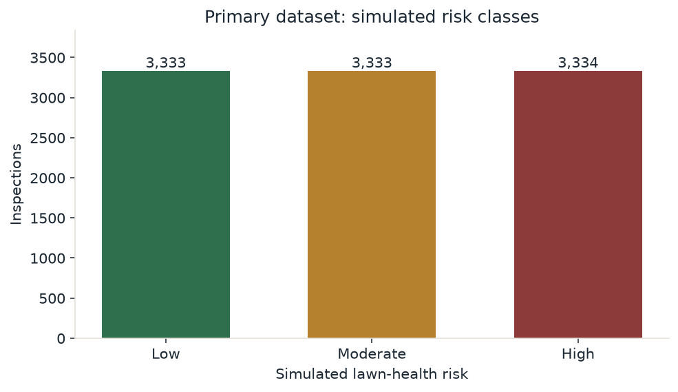

*Figure 1. Simulated class counts in the primary file. The near-balance is produced by the tertile rule.*

Continuous draws are clipped to the documented bounds inside the generator. Validation does not clip rows afterwards to force a pass.

# 9. Data dictionary and preprocessing

The model sees 23 inputs in five groups: lawn and site, soil measurements, environment, maintenance, and visible observations. Units, bounds, and categories are in data/data_dictionary.md. Pipelines impute numeric medians and categorical modes, one-hot encode categories with unknown levels ignored, and scale numerics only for logistic regression and the SVM. Imputers and encoders are fit inside the training partition. The target and the intermediate score used to assign it are not features.

Laboratory pH and nutrient values are missing more often when the last service was at least 100 days earlier. Primary missingness: {'nitrogen_mg_kg': 0.0865, 'phosphorus_mg_kg': 0.0453, 'potassium_mg_kg': 0.0462, 'soil_ph': 0.0307}. An unknown value in the application is passed through as missing. It is not replaced with a healthy constant before the pipeline.

# 10. Experimental setup and split

The primary 10,000 rows were stratified by the simulated risk label into 7000 training, 1500 validation, and 1500 test rows (seed 42). Validation metrics come from models fit on training rows only. Test and robustness metrics come from the refit on training plus validation. The same row identifiers were used for every model.

Hyperparameters were pre-specified. Validation metrics use a fit on the training split only. Final models are refit on training plus validation and then scored once on the test split and on the separate robustness file. Permutation importance, calibration statistics, bootstrap intervals, and ablation use those final predictions. None of those evaluation steps changes the saved predictions.

Software recorded with the run: Python 3.14.7; numpy 2.5.4, pandas 3.1.0, scikit-learn 1.9.1, scipy 1.18.1, streamlit 1.66.1, plotly 7.1.0, joblib 1.6.0, matplotlib 3.11.2, python-docx 1.2.0, python-pptx 1.0.2, pytest 9.1.1. Training timestamp 2026-10-22T12:35:19+00:00.

# 11. Four classifier descriptions

Logistic regression: L2 logistic regression, C=1, lbfgs, scaled numeric inputs.

Random forest: 200 trees, max_depth=10, min_samples_leaf=8, max_features=sqrt.

Gradient boosting: 300 trees, learning_rate=0.05, max_depth=3, subsample=0.85. A validation-only grid preferred this over 150 trees at learning rate 0.08. The test set was not part of that choice..

Svm rbf: RBF kernel, C=1, gamma=scale. Class probabilities come from CalibratedClassifierCV with sigmoid method, cv=3, and ensemble=False, fit on the training rows only..

Logistic regression tests a linear boundary. The forest and the boosting model can use interactions such as heat with dryness. The SVM uses a nonlinear RBF kernel. Its probabilities come from a three-fold sigmoid calibrator fit on the training rows, not from the test set. A validation-only grid preferred gradient boosting with 300 trees, depth 3, and learning rate 0.05 over a shorter schedule. Deeper forests did not move validation accuracy much past the mid-0.70s, so the reported forest stays depth-limited.

# 12. Soft voting

Equal weights. The class is the largest mean probability. Weights were not tuned on the test set.

Soft voting is the only ensemble: for each class, average the four probabilities and choose the largest. Removing one model for the ablation does not retrain the other three.

# 13. Metrics

Accuracy is the share of test rows whose predicted class matches the simulated label. Precision, recall, and F1 are reported per class and as macro and weighted averages. Macro-F1 treats the three classes equally. A confusion matrix shows which simulated class was confused with which prediction. The high-risk row predicted as low risk is the miss emphasised in the discussion. Bootstrap intervals resample the stored predictions and do not refit the models. They are not real-world confidence intervals.

# 14. Results and model comparison

| Model | Accuracy | Macro-precision | Macro-recall | Macro-F1 | Weighted-F1 | High called low |
| --- | --- | --- | --- | --- | --- | --- |
| logistic regression | 80.6% | 80.7% | 80.6% | 80.7% | 80.7% | 0 |
| random forest | 74.9% | 75.2% | 74.9% | 75.0% | 75.0% | 0 |
| gradient boosting | 84.3% | 84.4% | 84.3% | 84.3% | 84.3% | 0 |
| svm rbf | 86.8% | 87.0% | 86.8% | 86.9% | 86.9% | 0 |
| soft voting | 86.0% | 86.0% | 86.0% | 86.0% | 86.0% | 0 |
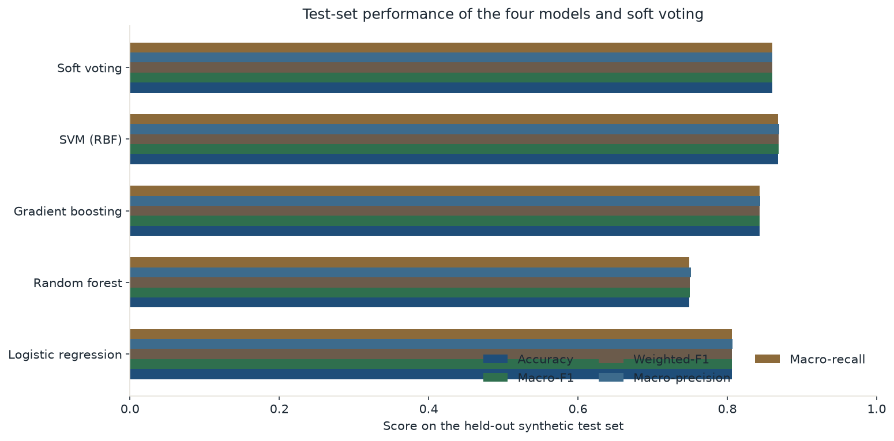

*Figure 2. Test-set scores for the four classifiers and soft voting. All bars use the same held-out rows.*

All figures in this comparison are from the same untouched test partition (n = 1500), after the models were refit on training plus validation. The highest test accuracy is SVM (RBF) at 86.8% (macro-F1 86.9%). Soft voting accuracy is 86.0%. It does not beat SVM (RBF) (86.8%) on this test set. Equal-weight averaging was still reported because it was the pre-specified ensemble, not because the test set selected it. Soft voting misses 46 of 500 simulated high-risk cases, including 0 that it calls low risk. Accuracy alone hides that difference. These percentages describe the synthetic benchmark only.

Validation scores from the training-only fit are stored in model_metrics.json under validation_before_refit. They are not plotted against the test scores. The table above is the test set after the refit.

# 15. Confusion matrices and class-wise performance

*Figure. Confusion matrix for logistic regression on the test set. Rows are the simulated class and columns are the prediction.*

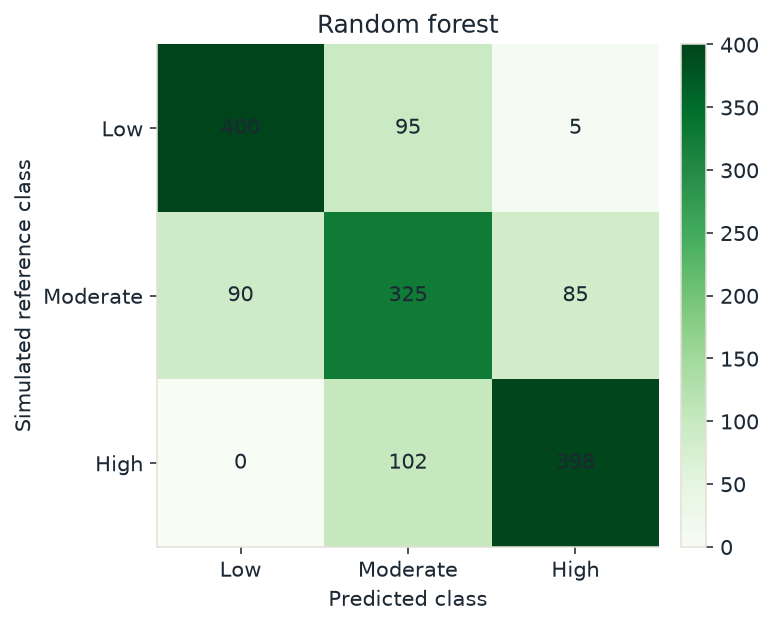

*Figure. Confusion matrix for random forest on the test set. Rows are the simulated class and columns are the prediction.*

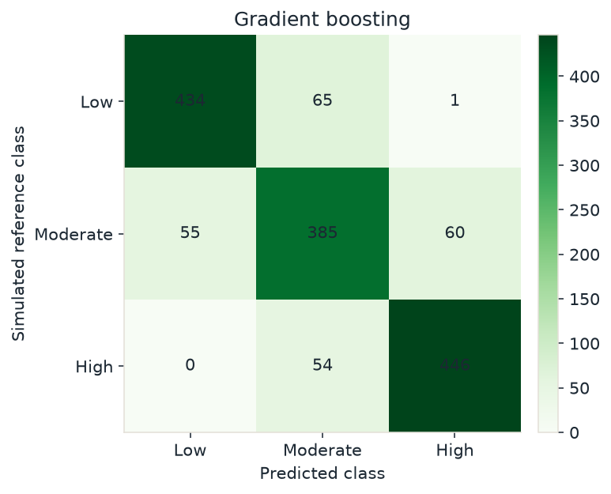

*Figure. Confusion matrix for gradient boosting on the test set. Rows are the simulated class and columns are the prediction.*

*Figure. Confusion matrix for svm rbf on the test set. Rows are the simulated class and columns are the prediction.*

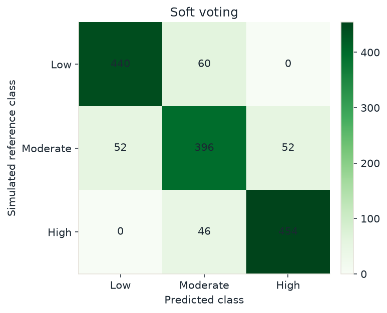

*Figure. Confusion matrix for soft voting on the test set. Rows are the simulated class and columns are the prediction.*

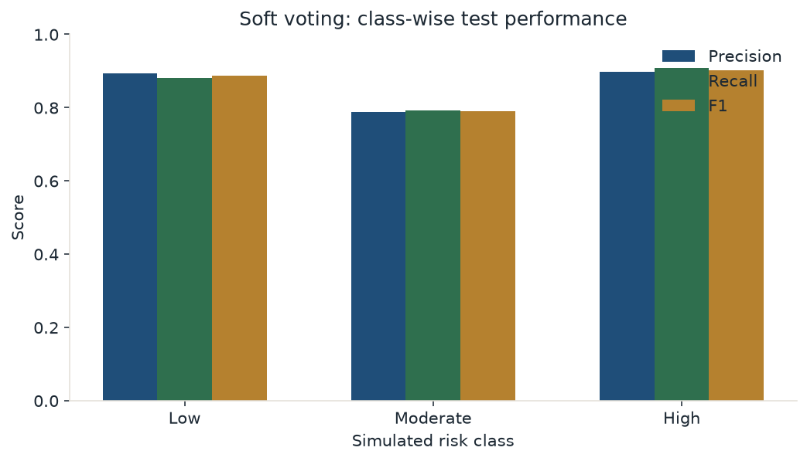

*Figure. Soft-voting precision, recall, and F1 by simulated class.*

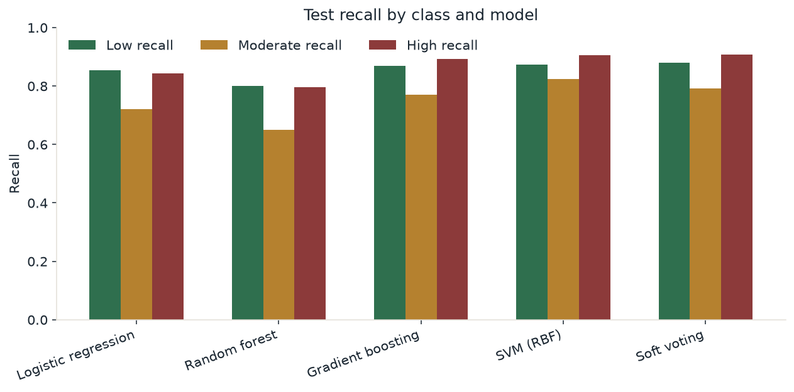

*Figure. Test recall by class for every reported model.*

Recall is uneven. The weakest class for soft voting is Moderate (79.2%) and the strongest is High (90.8%). High-risk precision is 89.7% and high-risk recall is 90.8% on 500 test rows. A missed high-risk case is the error a follow-up plan should not ignore. Class-wise scores use the simulated labels.

# 16. Explainability

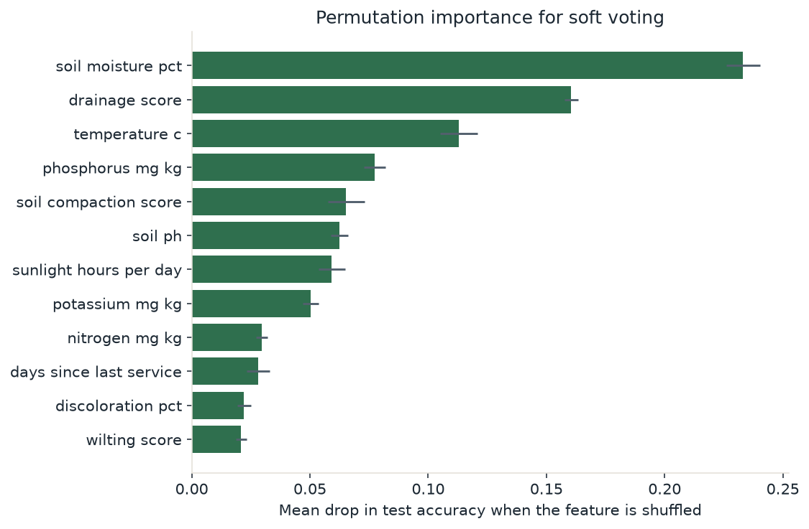

*Figure. Permutation importance for soft voting on the test set. Error bars are the standard deviation across repeats.*

Permutation importance is the drop in test accuracy when a column is shuffled. The largest mean drops for this model are soil moisture pct (23.3 accuracy points), drainage score (16.1 accuracy points), temperature c (11.3 accuracy points), phosphorus mg kg (7.7 accuracy points), soil compaction score (6.5 accuracy points). A large drop means the fitted model depends on that column in this synthetic test set. It does not mean the column caused the lawn condition, and it can give credit to a proxy for a latent variable the model never saw.

For a single inspection the application replaces one observed value with the fitting-set median or mode and records the change in the soft-voting probability of the predicted class. A missing measurement is not given a contrast. The explanation is dependence of this model, not a cause of the lawn's condition.

# 17. Robustness

| Model | Accuracy | Macro-precision | Macro-recall | Macro-F1 | Weighted-F1 | High called low |
| --- | --- | --- | --- | --- | --- | --- |
| logistic regression | 83.7% | 80.6% | 78.2% | 79.3% | 83.4% | 3 |
| random forest | 79.5% | 73.2% | 74.2% | 73.7% | 79.7% | 4 |
| gradient boosting | 86.0% | 82.5% | 81.9% | 82.2% | 86.1% | 0 |
| svm rbf | 87.8% | 85.4% | 83.6% | 84.5% | 87.7% | 0 |
| soft voting | 87.8% | 85.4% | 83.7% | 84.5% | 87.7% | 0 |
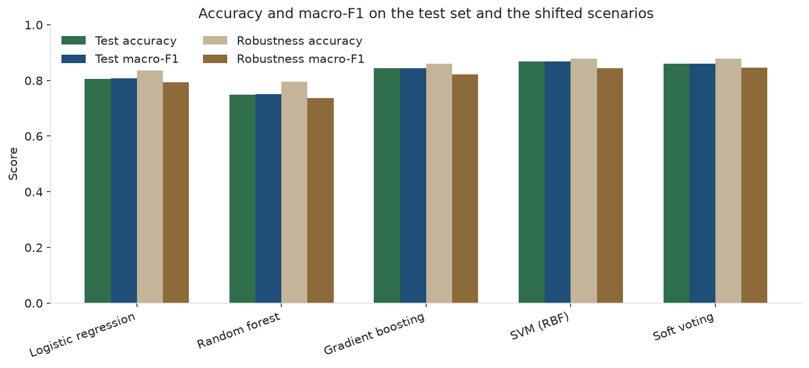

*Figure. Accuracy on the standard test set and on the separately generated robustness file.*

The robustness file was generated with a different seed, a hotter and drier latent climate, a warmer grass mix, more traffic, less rain, higher laboratory missingness, and the original score cutoffs. It does not reuse test rows. Test accuracy versus robustness accuracy: Logistic regression 80.6% to 83.7% (+3.0 points); Random forest 74.9% to 79.5% (+4.6 points); Gradient boosting 84.3% to 86.0% (+1.7 points); SVM (RBF) 86.8% to 87.8% (+1.0 points); Soft voting 86.0% to 87.8% (+1.8 points). Soft voting is higher on the shifted sample. A drop means the benchmark is sensitive to the designed shift. It is not an estimate of performance under real climate change.

# 18. Ablation and error analysis

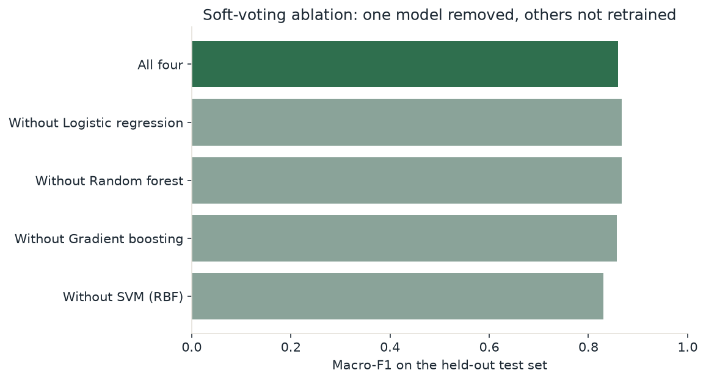

*Figure. Test macro-F1 for the full soft vote and for each leave-one-out average. The remaining models are not retrained.*

Full soft voting has test macro-F1 86.0%. Leave-one-out averages use the same fitted models and do not retrain the others. without Logistic regression: macro-F1 86.7% (+0.7 points); without Random forest: macro-F1 86.8% (+0.7 points); without Gradient boosting: macro-F1 85.7% (-0.3 points); without SVM (RBF): macro-F1 83.0% (-3.0 points). Removing SVM (RBF) lowers macro-F1 by more than half a point, so those models contribute something the others do not fully replace on this test set.

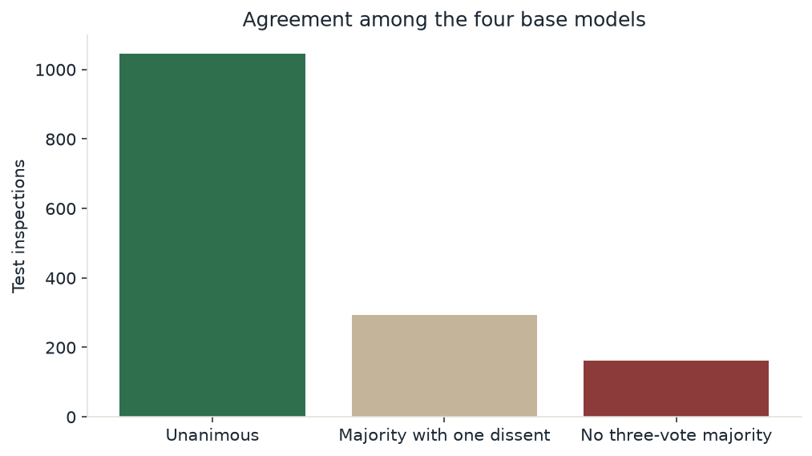

*Figure. Agreement among the four base models on the test set.*

Of 1500 test rows, 1045 are unanimous, 293 have a single dissent, and 162 have no three-vote majority.

Saved error examples include high-risk rows called low, rows where the models disagree, and high-risk rows the ensemble got right. They are in reports/error_examples.json. Recurring difficulty is expected near the score cutoffs, where the noise term can move a row across a boundary, and where a laboratory value was hidden.

# 19. Calibration

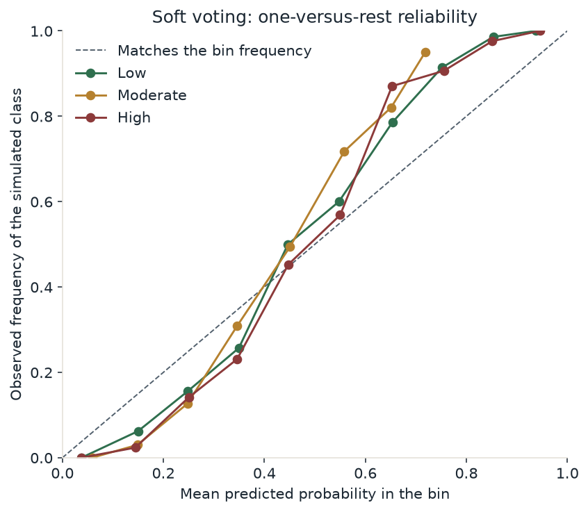

*Figure. One-versus-rest reliability of the soft-voting probabilities on the test set.*

For soft voting, the one-versus-rest macro expected calibration error is 0.090 and the multiclass Brier score is 0.239, both computed on the test predictions. A reliability point near the diagonal means that, inside that probability bin, the simulated label occurred about as often as the probability suggested. Empty bins are omitted. These quantities were not used to refit or recalibrate the models. They do not make the probabilities into real-world confidence.

# 20. Decision support and recommendations

Water, nutrient, and drainage screens are written rules. They do not emit probabilities and they were not fit as classifiers. Water rules use low moisture with heat, a dry week with little irrigation, a high wilting score, and frequent irrigation that has not raised moisture. Nutrient rules use the Maryland pH discussion and project-only mg/kg bands that are not laboratory sufficiency classes. Rutgers' statement that a routine soil test does not establish nitrogen need is shown whenever a low nitrogen value is discussed. Drainage rules use the worker drainage score, compaction, fine texture, and wet soil. Actions ask for a soil test, an irrigation inspection, a drainage look, aeration when compaction is high, a sunlight review, a thatch check above about 12.7 mm, and a follow-up. No action states a fertiliser, lime, sulfur, or pesticide rate. A high overall class does not by itself create a nutrient action.

Priority is urgency weight times evidence strength. Cost is shown separately and does not change the rank. The follow-up interval is 14, 28, or 56 days according to the class and the screens. It is an operational heuristic. Comparing two saved assessments shows input changes and a new prediction. It does not estimate a treatment effect.

# 21. Business cost-estimation methodology

Each priced action is a flat amount plus a per-square-metre amount times the entered lawn area. The default books are labelled illustrative Indian rupees and a separate illustrative US dollar schedule. The dollar schedule is not an exchange-rate conversion. A minimal plan prices the high-urgency actions. A comprehensive plan adds the medium-urgency actions. Users can edit every flat fee and every per-square-metre rate. The result is a calculated illustration. It is not an invoice, a replacement-cost study, or evidence of savings.

# 22. Application design and demonstration

The Streamlit application has an overview, a lawn assessment with recommendations and costs, a demonstration lab, and a combined results and data page. The demonstration loads one held-out test row, runs the four saved pipelines, averages the probabilities, and only then shows the simulated benchmark label. The operational page does not show that label, because a new lawn does not have one. Models are loaded from disk. Page changes do not refit them. A fingerprint check warns if the CSV and the saved run diverge.

# 23. Limitations and threats to validity

- The labels are simulated. Agreement with them is not agronomic truth.
- Extension pages are from Maryland, New Jersey, and an FAO index. They are not a sample of Indian lawns, and the rupee prices are not a local survey.
- Project mg/kg bands are not a soil-test method.
- Ordinal scores are treated as equally spaced numbers by the linear model.
- Median imputation fills missing laboratory values with a training statistic. That statistic was not measured on the lawn.
- Probability estimates can be misread as real-world confidence. The calibration plot is the check, and it uses synthetic labels.
- The robustness file changes several things at once, so a drop cannot be attributed to one factor.
- Ablation does not retrain the remaining models.
- Bootstrap intervals do not refit the models and do not describe customer lawns.
- Validation was used to revise the generator once and to choose the boosting schedule. The test set was not used for those choices, but the validation split of the final generator was inspected, so the validation metrics are not a second untouched test.

# 24. Conclusion and recommendations

All figures in this comparison are from the same untouched test partition (n = 1500), after the models were refit on training plus validation. The highest test accuracy is SVM (RBF) at 86.8% (macro-F1 86.9%). Soft voting accuracy is 86.0%. It does not beat SVM (RBF) (86.8%) on this test set. Equal-weight averaging was still reported because it was the pre-specified ensemble, not because the test set selected it. Soft voting misses 46 of 500 simulated high-risk cases, including 0 that it calls low risk. Accuracy alone hides that difference. These percentages describe the synthetic benchmark only.

Full soft voting has test macro-F1 86.0%. Leave-one-out averages use the same fitted models and do not retrain the others. without Logistic regression: macro-F1 86.7% (+0.7 points); without Random forest: macro-F1 86.8% (+0.7 points); without Gradient boosting: macro-F1 85.7% (-0.3 points); without SVM (RBF): macro-F1 83.0% (-3.0 points). Removing SVM (RBF) lowers macro-F1 by more than half a point, so those models contribute something the others do not fully replace on this test set.

The robustness file was generated with a different seed, a hotter and drier latent climate, a warmer grass mix, more traffic, less rain, higher laboratory missingness, and the original score cutoffs. It does not reuse test rows. Test accuracy versus robustness accuracy: Logistic regression 80.6% to 83.7% (+3.0 points); Random forest 74.9% to 79.5% (+4.6 points); Gradient boosting 84.3% to 86.0% (+1.7 points); SVM (RBF) 86.8% to 87.8% (+1.0 points); Soft voting 86.0% to 87.8% (+1.8 points). Soft voting is higher on the shifted sample. A drop means the benchmark is sensitive to the designed shift. It is not an estimate of performance under real climate change.

Recommendations for anyone using the prototype: treat a disagreement among the four models as a reason to reinspect; do not convert the class into a fertiliser rate; obtain a laboratory soil test before a nutrient or lime decision; read a high-to-low error as the operational miss that matters on this benchmark; and edit the price book before discussing a budget. Recommendations for the work itself: the benchmark is strong enough to compare models and weak as evidence about real lawns. A later study needs real inspections with a documented labelling protocol before anyone claims field accuracy or a business result.

# References

- University of Maryland Extension. Starting a New Lawn. https://extension.umd.edu/resource/starting-new-lawn. Accessed 22 October 2026.
- University of Maryland Extension. Maintaining an Established Lawn. https://extension.umd.edu/resource/maintaining-established-lawn. Accessed 22 October 2026.
- Heckman, J. Soil Testing for Home Lawns and Gardens (FS797). Rutgers Cooperative Extension. https://njaes.rutgers.edu/fs797/. Accessed 22 October 2026.
- Heckman, J. and Murphy, J. A. Fertilizing the Home Lawn (FS633). Rutgers Cooperative Extension. https://njaes.rutgers.edu/FS633/. Accessed 22 October 2026.
- Murphy, J. A. Your Lawn and Its Care (FS102). Rutgers Cooperative Extension. https://njaes.rutgers.edu/fs102/. Accessed 22 October 2026.
- Food and Agriculture Organization of the United Nations. EcoCrop home page. https://ecocrop.apps.fao.org/ecocrop/srv/en/home. Accessed 22 October 2026. No species records were downloaded.
